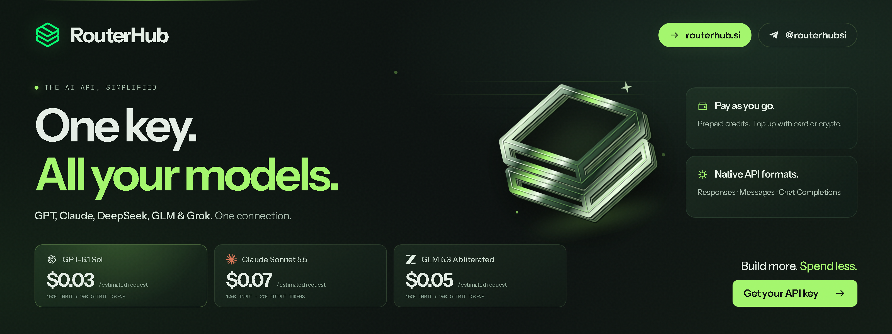

<div align="center">

<a href="https://routerhub.si/?utm_source=github&utm_medium=readme&utm_campaign=uncensored-models">
  
</a>

# Uncensored Models — every model, what it does, and where to get it

**An uncensored model is a language model variant with fewer built-in refusals than the standard release — delivered either as a hosted API variant or as open weights. This is a library of them: browse by family, see what each variant is and does, pick up the free open weights, or use a hosted API variant.**

<p align="center">
  <a href="https://routerhub.si/?utm_source=github&utm_medium=readme&utm_campaign=uncensored-models"></a>
  <a href="https://t.me/routerhubsi"></a>
  <a href="https://routerhub.si/register?next=onboarding&utm_source=github&utm_medium=readme&utm_campaign=uncensored-models"></a>
</p>

</div>

---

Maintained by [RouterHub](https://routerhub.si/?utm_source=github&utm_medium=readme&utm_campaign=uncensored-models) · Last updated: **November 2, 2026** · Prices: USD per million tokens, checked against the [public catalogue](https://routerhub.si/models.json).

## About

This repository indexes uncensored and abliterated language models — official tuned variants and community weight-level builds — organized by family, with specs, prices and links to Hugging Face repos. Each model has its own entry under [`models/`](models/):

- [`glm-5.3-uncensored`](models/glm-5.3-uncensored.md) · [`glm-5.3-flash-uncensored`](models/glm-5.3-flash-uncensored.md) · [`glm-5.3-abliterated`](models/glm-5.3-abliterated.md) · [`glm-5.3-flash-abliterated`](models/glm-5.3-flash-abliterated.md)
- [`deepseek-v4-pro-uncensored`](models/deepseek-v4-pro-uncensored.md) · [`deepseek-v4.1-flash-uncensored`](models/deepseek-v4.1-flash-uncensored.md) · [`deepseek-v4.1-flash-abliterated`](models/deepseek-v4.1-flash-abliterated.md) · [`deepseek-v4.1-flash-1017-abliterated`](models/deepseek-v4.1-flash-1017-abliterated.md) · [`deepseek-v4-pro-abliterated`](models/deepseek-v4-pro-abliterated.md)
- [`qwen3.8-max-uncensored`](models/qwen3.8-max-uncensored.md)

To add or correct an entry, open an issue.

## GLM (Z.ai)

Z.ai's GLM 5.3 family ships official uncensored variants (tuned to refuse less), and there is an active community abliteration scene around the Flash release. The abliterated variants have publicly recorded evaluation runs — see [Eval runs](#eval-runs).

**Hosted variants** — prices checked 2026-11-02:

| Model | Input | Cached input | Output | Context window |
|---|---:|---:|---:|---:|
| `glm-5.3-uncensored` | $0.20 | $0.12 | $0.63 | not published |
| `glm-5.3-flash-uncensored` | $0.15 | $0.0135 | $0.50 | not published |
| `glm-5.3-abliterated` | $0.40 | $0.16 | $1.33 | 1,048,576 |
| `glm-5.3-flash-abliterated` | $0.30 | $0.12 | $1.00 | 1,048,576 |

**Open weights on Hugging Face** (downloads as of 2026-11-02):

| Build | Downloads | Likes |
|---|---:|---:|
| [BoldingBuilds/orcarouter_GLM-5.3-Flash-Uncensored-GGUF](https://huggingface.co/BoldingBuilds/orcarouter_GLM-5.3-Flash-Uncensored-GGUF) | 504,769 | 37 |
| [GCSA-AiLab/GLM-5.3-Flash-Uncensored-RCO-GSQ-GGUF](https://huggingface.co/GCSA-AiLab/GLM-5.3-Flash-Uncensored-RCO-GSQ-GGUF) | 54,592 | 10 |
| [huihui-ai/Huihui-GLM-5.3-Flash-abliterated-GGUF](https://huggingface.co/huihui-ai/Huihui-GLM-5.3-Flash-abliterated-GGUF) | 44,757 | 343 |
| [DavidAU/GLM-4.7-Flash-Uncensored-Heretic-NEO-CODE-Imatrix-MAX-GGUF](https://huggingface.co/DavidAU/GLM-4.7-Flash-Uncensored-Heretic-NEO-CODE-Imatrix-MAX-GGUF) | 36,687 | 441 |
| [AliceThirty/GLM-5.3-Flash-UNCENSORED-GGUF](https://huggingface.co/AliceThirty/GLM-5.3-Flash-UNCENSORED-GGUF) | 29,302 | 22 |
| [orcarouter/GLM-5.3-Flash-Uncensored-FP8](https://huggingface.co/orcarouter/GLM-5.3-Flash-Uncensored-FP8) | 25,518 | 316 |
| [softwareweaver/GLM-5.3-Uncensored-GGUF](https://huggingface.co/softwareweaver/GLM-5.3-Uncensored-GGUF) | 22,161 | 17 |
| [audnai/penclaw-GLM-5.3-abliterated](https://huggingface.co/audnai/penclaw-GLM-5.3-abliterated) | 2,860 | 521 |

## DeepSeek

DeepSeek's uncensored program covers both the flagship size (`v4-pro`) and the fast Flash model, in tuned and abliterated flavors — including a pinned October 2026 abliterated build for reproducible behavior.

**Hosted variants** — prices checked 2026-11-02:

| Model | Input | Cached input | Output | Context window |
|---|---:|---:|---:|---:|
| `deepseek-v4-pro-uncensored` | $0.20 | $0.0016 | $0.40 | not published |
| `deepseek-v4.1-flash-uncensored` | $0.15 | $0.0027 | $0.60 | not published |
| `deepseek-v4.1-flash-abliterated` | $0.30 | $0.055 | $1.25 | 1,000,000 |
| `deepseek-v4.1-flash-1017-abliterated` | $0.30 | $0.055 | $1.25 | 1,000,000 |
| `deepseek-v4-pro-abliterated` | $0.40 | $0.04 | $1.60 | 1,000,000 |

**Open weights on Hugging Face** (downloads as of 2026-11-02):

| Build | Downloads | Likes |
|---|---:|---:|
| [Abiray/DeepSeek-V4.1-Flash-1017-Uncensored-GSQ-RCO-IQ2_XXS-GGUF](https://huggingface.co/Abiray/DeepSeek-V4.1-Flash-1017-Uncensored-GSQ-RCO-IQ2_XXS-GGUF) | 366,471 | 67 |
| [huihui-ai/Huihui-DeepSeek-V4-Flash-0731-abliterated-GGUF](https://huggingface.co/huihui-ai/Huihui-DeepSeek-V4-Flash-0731-abliterated-GGUF) | 365,035 | 235 |
| [huihui-ai/Huihui-DeepSeek-V4-Flash-abliterated-ds4-GGUF](https://huggingface.co/huihui-ai/Huihui-DeepSeek-V4-Flash-abliterated-ds4-GGUF) | 284,206 | 149 |
| [audreyt/DeepSeek-V4.1-Flash-Abliterated-GGUF](https://huggingface.co/audreyt/DeepSeek-V4.1-Flash-Abliterated-GGUF) | 80,099 | 14 |
| [pyrodog/DeepSeek-V4.1-Flash-UNCENSORED-DwarfStar-Q2](https://huggingface.co/pyrodog/DeepSeek-V4.1-Flash-UNCENSORED-DwarfStar-Q2) | 49,457 | 20 |
| [Adolphsson/DeepSeek-V4.1-Flash-UNCENSORED-GGUF](https://huggingface.co/Adolphsson/DeepSeek-V4.1-Flash-UNCENSORED-GGUF) | 37,641 | 11 |
| [dealignai/DeepSeek-V4.1-Flash-UNCENSORED-FP8](https://huggingface.co/dealignai/DeepSeek-V4.1-Flash-UNCENSORED-FP8) | 33,180 | 818 |

## Qwen

The largest uncensored ecosystem on Hugging Face. The hosted `qwen3.8-max-uncensored` variant ($0.25 input / $0.75 output per million tokens, 1,000,000-token context, checked 2026-11-02) gives you the max-size model without a GPU; community builds below cover the 27B, 35B and Flash generations.

| Build | Downloads | Likes |
|---|---:|---:|
| [SC117/Qwen3.8-Flash-Next-GSQ-RCO-abliterated-GGUF](https://huggingface.co/SC117/Qwen3.8-Flash-Next-GSQ-RCO-abliterated-GGUF) | 3,553,530 | 609 |
| [huihui-ai/Huihui-Qwen3.8-27B-abliterated-GGUF](https://huggingface.co/huihui-ai/Huihui-Qwen3.8-27B-abliterated-GGUF) | 3,249,724 | 1,664 |
| [JonathanColetti/Qwen3.8-27B-Uncensored-GGUF](https://huggingface.co/JonathanColetti/Qwen3.8-27B-Uncensored-GGUF) | 2,619,075 | 1,858 |
| [HauhauCS/Qwen3.8-27B-Uncensored-HauhauCS-Aggressive-MTP-GGUF](https://huggingface.co/HauhauCS/Qwen3.8-27B-Uncensored-HauhauCS-Aggressive-MTP-GGUF) | 2,379,869 | 2,209 |
| [huihui-ai/Huihui-Qwen3.6-35B-A3B-abliterated-MTP-GGUF](https://huggingface.co/huihui-ai/Huihui-Qwen3.6-35B-A3B-abliterated-MTP-GGUF) | 2,297,059 | 70 |
| [DavidAU/Qwen3.5-9B-The-Defiant-Fable-Uncensored-Heretic-NEO-IMATRIX-MAX-MTP-GGUF](https://huggingface.co/DavidAU/Qwen3.5-9B-The-Defiant-Fable-Uncensored-Heretic-NEO-IMATRIX-MAX-MTP-GGUF) | 1,967,913 | 1,312 |
| [DavidAU/Qwen3.8-27B-TURBO-Fable-Cold-Fusion-735-882-Heretic-Uncensored-NEO-CODER-MAX-MTP-GGUF](https://huggingface.co/DavidAU/Qwen3.8-27B-TURBO-Fable-Cold-Fusion-735-882-Heretic-Uncensored-NEO-CODER-MAX-MTP-GGUF) | 1,356,658 | 2,308 |
| [orcarouter/Qwen3.8-Flash-Next-Uncensored-GGUF](https://huggingface.co/orcarouter/Qwen3.8-Flash-Next-Uncensored-GGUF) | 1,149,873 | 1,246 |
| [0bserverx/Qwen3.8-27B-Heretic-Abliterated-Uncensored-GGUF](https://huggingface.co/0bserverx/Qwen3.8-27B-Heretic-Abliterated-Uncensored-GGUF) | 1,129,666 | 819 |
| [HauhauCS/Qwen3.6-35B-A3B-Uncensored-HauhauCS-Aggressive](https://huggingface.co/HauhauCS/Qwen3.6-35B-A3B-Uncensored-HauhauCS-Aggressive) | 1,111,177 | 4,075 |

## More community releases

- [mradermacher/Ornith-1.5-9B-uncensored-GGUF](https://huggingface.co/mradermacher/Ornith-1.5-9B-uncensored-GGUF) — 1,709,749 downloads
- [HauhauCS/Gemma-4-E4B-Uncensored-HauhauCS-Aggressive](https://huggingface.co/HauhauCS/Gemma-4-E4B-Uncensored-HauhauCS-Aggressive) — 801,900 downloads
- [DavidAU/Llama-3.2-8X3B-MOE-Dark-Champion-Instruct-uncensored-abliterated-18.4B-GGUF](https://huggingface.co/DavidAU/Llama-3.2-8X3B-MOE-Dark-Champion-Instruct-uncensored-abliterated-18.4B-GGUF) — 39,069 downloads
- [mradermacher/gemma-4-12B-it-abliterated-uncensored-GGUF](https://huggingface.co/mradermacher/gemma-4-12B-it-abliterated-uncensored-GGUF) — 21,575 downloads

Downloads as of 2026-11-02. Check each repo's license and model card before use.

## Running them

**Free (open weights):** grab any build above and run it locally with llama.cpp, Ollama or LM Studio. Download counts are all-time values from the Hugging Face API.

**Hosted (no GPU):** every variant in the hosted tables is served by RouterHub through one OpenAI- and Anthropic-compatible endpoint — pay per token. Setup guides in [uncensored-ai-api](https://github.com/routerhubSI/uncensored-ai-api).

```python
import os
from openai import OpenAI

client = OpenAI(
    api_key=os.environ["ROUTERHUB_API_KEY"],
    base_url=os.environ["ROUTERHUB_BASE_URL"],  # copy from the dashboard
)

response = client.chat.completions.create(
    model="glm-5.3-flash-abliterated",  # any variant ID above
    messages=[{"role": "user", "content": "Write a noir paragraph about a lighthouse."}],
)
print(response.choices[0].message.content)
```

## Eval runs

Recorded comparisons for the GLM entries — standard, uncensored and abliterated — are public in [model evals](https://github.com/routerhubSI/routerhub-model-evals): raw requests and responses, candidate hashes, and sandbox-scored acceptance results.

## Uncensored vs abliterated

**Uncensored** — tuned or trained to refuse less. **Abliterated** — refusal direction removed from the weights of an existing model, without retraining.

Neither guarantees refusal-free output. Longer comparison: [uncensored vs abliterated models](https://github.com/routerhubSI/uncensored-ai-api/blob/main/docs/02-uncensored-vs-abliterated-models.md).

## Notes

- Refusal behavior varies by model, version and prompt; re-evaluate after upstream releases.
- Hosted availability is labeled preview and rates rotate — confirm current prices in the catalogue before committing.
- Hugging Face download counts are cumulative all-time values and change daily.
- Missing a notable release? Open an issue.

## FAQ

**Can I run these locally?**

Yes — every open-weight table links to Hugging Face builds you can run with llama.cpp, Ollama or LM Studio.

**How do I add or correct a model?**

Open an issue or pull request. Hosted variants are added as providers ship them.

**Does uncensored mean no refusals ever?**

No. Refusal behavior varies by model, version and prompt. You remain responsible for lawful, ethical use.

---

<sub>Model names and trademarks belong to their respective owners.</sub>
